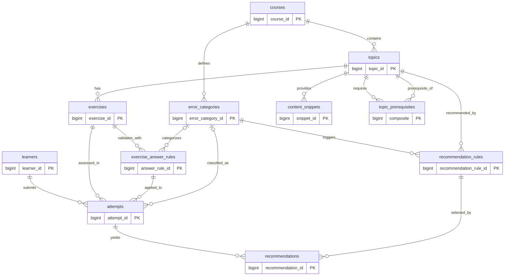

# Logical Database Schema — PostgreSQL OLTP

Based on `database/migrations/001_initial_schema.sql`. The Mermaid diagram is a logical view; consult the DDL and [data dictionary](DATA_DICTIONARY.md) for exact types and constraints.

## Main functional blocks

1. **Curriculum:** courses, topics, topic_prerequisites, content_snippets.
2. **Assessment:** exercises, exercise_answer_rules, error_categories, attempts.
3. **Recommendations:** recommendation_rules, recommendations.
4. **Learners:** learners, linked to their attempts.

The logical flow is: learner submits an exercise attempt; an answer rule classifies it; a recommendation rule maps an error category to a topic; the learner may accept or reject the resulting recommendation.
