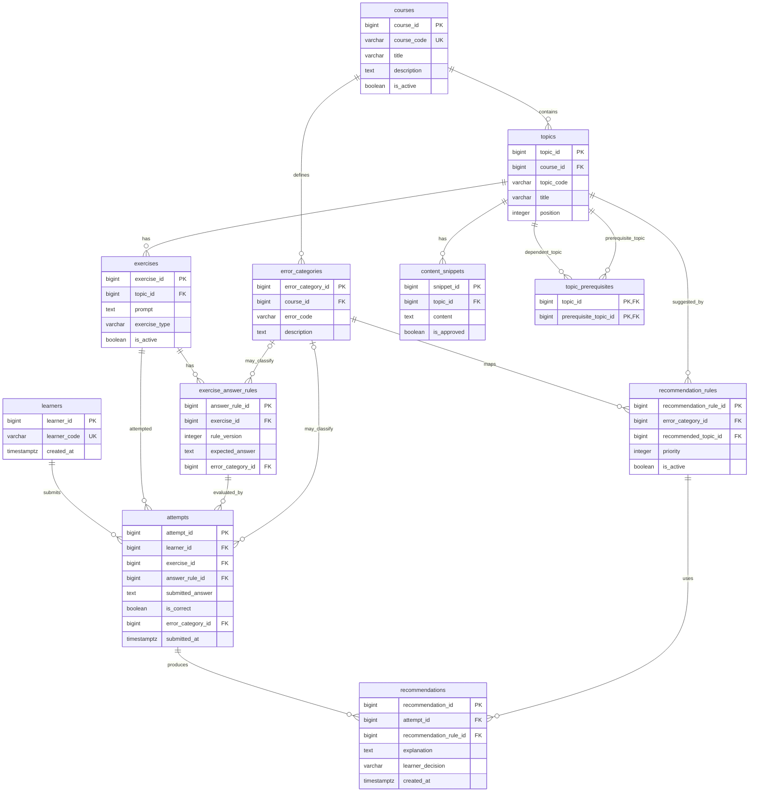

# Logical ER Diagram — PostgreSQL OLTP

This diagram documents the **actual tables and foreign-key relationships** declared in [001_initial_schema.sql](../migrations/001_initial_schema.sql). It is not a report of executed database tests. Nullable foreign keys are noted below; exact types, defaults and constraints are in the [data dictionary](DATA_DICTIONARY.md) and SQL migration.

## Interpretation

- **Curriculum:** `courses` contains `topics`; `topic_prerequisites` is a junction table with the composite primary key **(`topic_id`, `prerequisite_topic_id`)**, both referencing `topics`.
- **Exercises and assessment:** each exercise belongs to one topic. `exercise_answer_rules` stores versioned answer rules; each `attempts` record references one learner, exercise, and answer rule. The composite foreign key (`answer_rule_id`, `exercise_id`) ensures the answer rule belongs to the same exercise.
- **Error classification:** `exercise_answer_rules.error_category_id` and `attempts.error_category_id` are **nullable** foreign keys.
- **Recommendations:** `recommendation_rules` maps error categories to recommended topics; `recommendations` records the applied rule and the learner's `pending`, `accepted`, or `rejected` decision.
- **Cardinality:** a parent may have zero or more children. A nullable FK permits a missing referenced category; a NOT NULL FK requires a referenced row.
- **Scope note:** the SQL migration prevents self-prerequisites, but does not itself prevent prerequisite cycles or enforce same-course topic relationships for recommendation rules. These are known integrity considerations, not features claimed as implemented.

**Reference:** [Data Dictionary](DATA_DICTIONARY.md) · [Initial DDL](../migrations/001_initial_schema.sql) · [Database README](../README.md).
