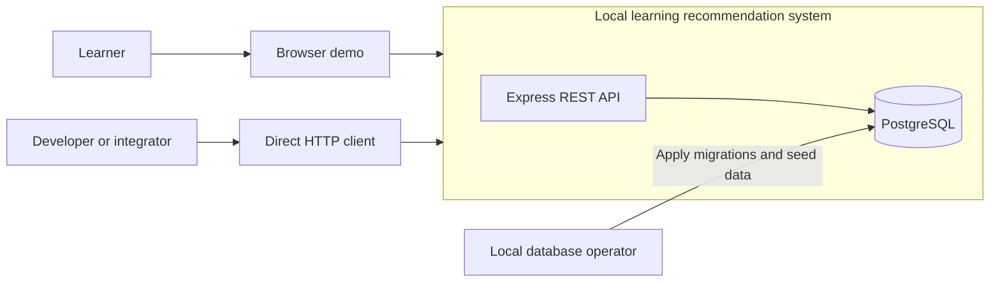
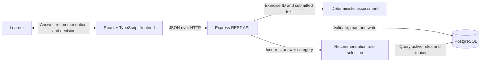
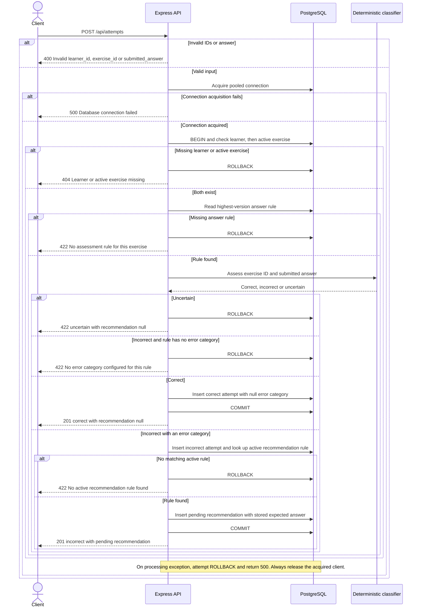
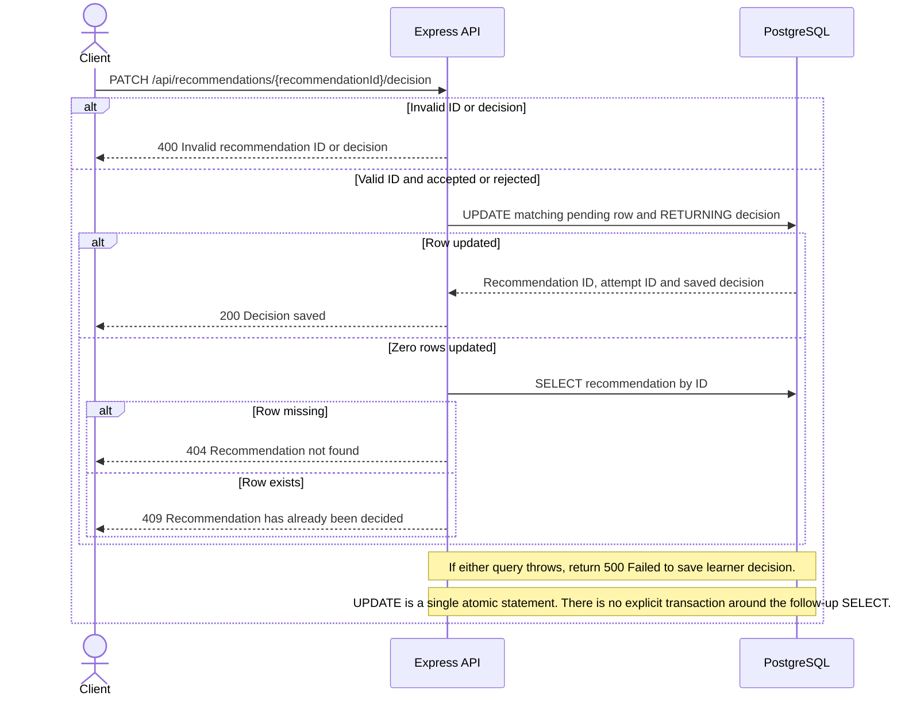

# System architecture

The current database-backed MVP runs a Python and Lithuanian diagnostic workflow. The earlier browser-only JavaScript prototype is described in the [October practice archive](../ARCHITECTURE.md).

## System context

The browser and direct clients use the same six-operation HTTP contract. The local operator provisions the schema and seed catalog. There is one API process and one PostgreSQL database connection pool per process.

## Components and dependencies

| Component | Current responsibility |
| --- | --- |
| [React frontend](../../src/App.tsx) | Fetches courses and exercises, submits answers using demo learner ID 1, displays assessment outcomes, and sends accept or reject decisions. Uses `http://localhost:3001` as its API base URL. |
| [Express API](../../server/index.ts) | Validates request fields, checks references and configures JSON parsing and CORS. Coordinates attempt transactions and performs a conditional update for learner decisions. |
| [Deterministic assessment](../../server/assessment.ts) | Applies Unicode NFC normalization, lowercasing, selected punctuation replacement and whitespace normalization. Compares the result against exact correct-answer and misconception variants for exercise IDs 1 and 2. Unmatched answers are uncertain. |
| Recommendation selection | For an incorrect answer, uses the error category from the highest-version answer rule for the exercise (highest rule ID breaks ties). Chooses the active recommendation rule with the lowest priority number, then lowest rule ID. The stored expected answer supplies the explanation. |
| [PostgreSQL](../../database/migrations/001_initial_schema.sql) | Stores the catalog, learners, answer rules, submitted answers, persisted recommendations and decisions. Correct attempts commit alone. Incorrect attempts and their recommendations commit together. |

Learners decide whether to follow a recommendation. An accepted or rejected decision is persisted on its recommendation row. This update does not change the rule set or track completion of the recommended topic.

| Caller | Dependency | Connection or invocation |
| --- | --- | --- |
| React or direct client | Express route handlers | Local HTTP, JSON for writes and handler responses |
| Express attempt handler | Deterministic assessment module | In-process TypeScript call with numeric exercise ID and raw answer |
| Express route handlers | `pg` pool and PostgreSQL | Parameterized SQL over the configured database connection |
| Attempt handler rule selection | Answer rules, error categories, recommendation rules and topics | SQL queries within the same attempt transaction |
| Express decision handler | Recommendations table | One conditional UPDATE, then an existence query only if the UPDATE returns no row |

## Sequence diagrams

Both write sequences begin after Express has matched the route and parsed JSON. Parser or path-decoding failures can terminate before route logic with the [framework error responses](API_DESIGN.md#error-taxonomy).

### Diagnostic answer and recommendation

Correct and incorrect outputs are returned after COMMIT. A recognized misconception is categorized using the chosen answer rule. The recommendation join selects the topic for the lowest priority number, then lowest recommendation rule ID. A missing rule after the attempt insert rolls back that insert. A processing exception attempts rollback and releases the client. PostgreSQL sequence values may still advance after rollback, so gaps in returned IDs do not imply missing committed attempts.

### Recommendation decision

The pending condition is part of the SQL UPDATE. Under competing accept and reject requests, one transition takes effect. A later request finds no pending row and returns 409 if the recommendation still exists. An existing decision cannot be overwritten through this route.

## Future LLM integration

A future LLM service could use structured learning context to draft explanations or suggest catalog topics. That design would need output validation and continued learner control. Today the classifier uses approved text variants, and recommendation selection and explanation come from database rules. The REST API makes no LLM calls.

See the [API integration guide](README.md) for local setup and the [security notes](SECURITY.md) for trust boundaries.
