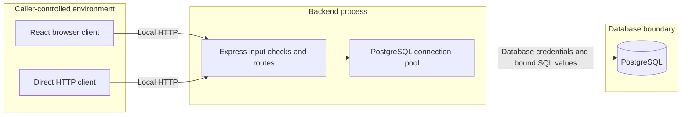

# API security and privacy

## Current behavior and controls

| Area | Implementation and limitations |
| --- | --- |
| Identity and authorization | The API has no authentication, sessions or authorization. The attempt handler checks whether the caller-supplied `learner_id` exists. A caller can submit under another learner's ID, and anyone with API access and a pending recommendation ID can decide it. The frontend's fixed demo learner ID is a convention. |
| Validation | The route handlers validate path IDs as positive decimal BIGINTs, attempt body IDs as positive safe integers, answer text as nonblank and at most 5,000 UTF-16 code units, and decisions as exactly `accepted` or `rejected`. They check the referenced learner and active exercise before saving the attempt. |
| SQL injection protection | [Route SQL](../../server/index.ts) binds request-controlled values as PostgreSQL query parameters (`$1`, `$2`, etc.). Query text and identifiers are fixed in the handlers. |
| CORS | Express configures `Access-Control-Allow-Origin` for `http://localhost:5173`. This controls which browser origin can read cross-origin responses. Direct HTTP clients can reach the API independently of CORS. |
| Configuration | [Database configuration](../../server/db.ts) reads `DB_HOST`, `DB_PORT`, `DB_USER`, `DB_PASSWORD` and `DB_NAME` from the process environment and loads a local `.env` via dotenv. The Express listener uses `PORT`. Keep actual credentials in the local ignored environment file or an environment-specific secret store. Keep them out of Vite variables, committed files and logs. |
| Data and logs | PostgreSQL stores the original answer text, learner linkage, timestamps and recommendation decisions. Use synthetic learner codes and answer text in demos. Free text can contain personal information. Restrict database and log access. The health route exposes the database name and backend errors can be written to server logs. |

The demo assumes a trusted local environment. Application-level TLS, request rate limiting, retention and deletion policies, and a security audit trail are absent. The server calls `app.listen(PORT)` without an explicit host, so restrict access at the network boundary when running it.

## Trust boundaries and ownership

The API trusts caller-supplied inputs only after validating their shape and referenced rows. Those checks establish that objects exist. The demo learner ID is a frontend convention and provides no proof of identity. The decision handler updates by recommendation ID and pending status. It does not check the relationship from recommendation to attempt to learner. In a multi-user deployment these gaps would create broken object-level authorization (BOLA) risks for learner records. Numeric IDs are references, and CORS and validation serve different purposes from ownership enforcement.

Use the local MVP within a trusted workstation or restricted development network. Keep PostgreSQL private, restrict the backend listener with the host or network boundary, and avoid public tunnels. Keep real database credentials in a local ignored environment file or managed secrets store. Give runtime and migration roles separate privileges in a future deployment. Avoid real learner data in reference seeds, examples and test environments. Free-text answers can contain sensitive information. Restrict access, minimize collected text, and define retention and deletion before enrolling real learners.

## Proposed authentication and authorization

1. Use an OpenID Connect provider with OAuth 2.0 Authorization Code and PKCE for the browser. Map the verified issuer and subject to a learner record on the server. Derive learner identity from that mapping for write operations.
2. Use short-lived access tokens with a defined audience and expiration. Validate issuer, audience, signature, allowed algorithm and expiry before route handling. Plan key rotation, recovery after expiry, and refresh-token rotation and revocation where the provider supports them. Keep tokens out of URLs and logs. If a browser backend manages sessions, use secure, HttpOnly cookies and define CSRF protection.
3. Require authentication for learner writes. Permit catalog reads only if the catalog policy allows public access. Keep detailed database health behind an operator boundary and use a minimal public readiness response if needed.
4. For a decision, resolve the recommendation's attempt owner and include that ownership predicate in the same conditional UPDATE as the pending-state predicate. Scope any future history or reconciliation reads to the same learner mapping. Review whether unauthorized object access should return 403 or a consistent 404 to avoid disclosing object existence. Define 401 and token expiry behavior in the future contract.
5. Require HTTPS at the deployment boundary and protect database transport on untrusted networks. Add scoped database permissions, secret rotation, rate limits and audit events that omit answer content. See [rate-limit and retry policy proposals](API_DESIGN.md#rate-limiting).

Any future deployment must decide who can access learner data and for how long. Define retention and deletion procedures, ownership test coverage and incident response before shared use. A future LLM design would require a separate review of data sent to external services.
