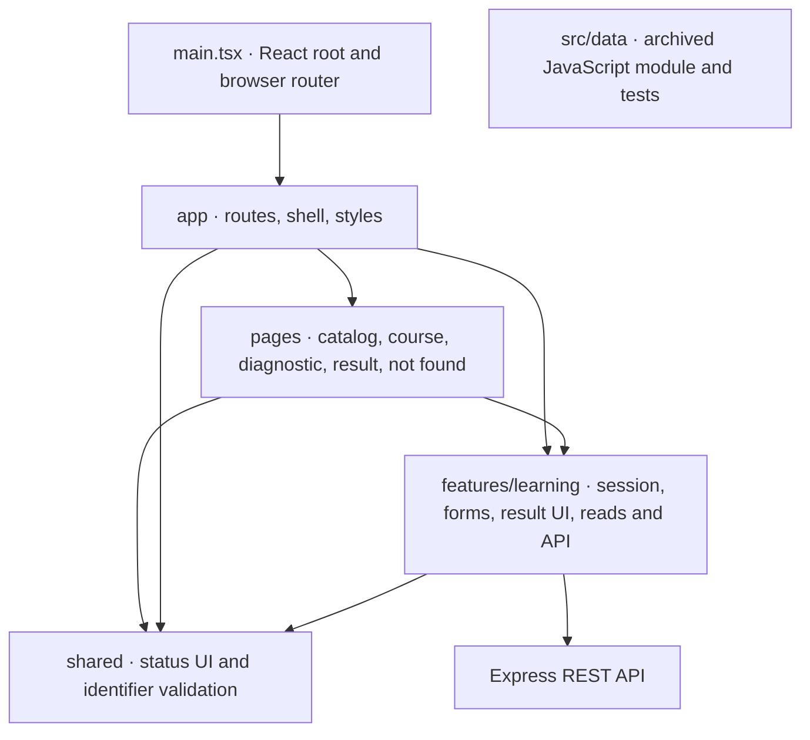
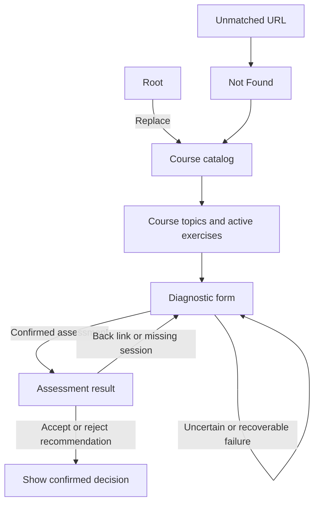
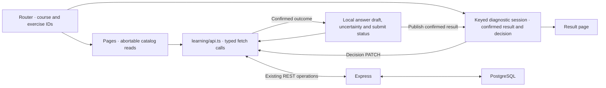

# Frontend architecture — FE-01

FE-01 starts from `7825b53f14fe916b5f1e0992fc97c2afba2650c2`, the merge of the baseline audit. The frontend presents the existing Python and Lithuanian diagnostics as a routed SPA. Express and PostgreSQL still own classification, recommendation generation, and persistence. [Baseline audit](BASELINE_AUDIT.md) · [API architecture](../api/ARCHITECTURE.md)

## Stack and module boundaries

React 19 keeps the existing rendering model and component ecosystem. TypeScript makes route parameters, assessment variants and decisions explicit. Vite bundles the existing SPA and emits separate page chunks from dynamic imports. React Router 8.5.3 is compatible with the project's React 19 and Node 24 setup and provides URL matching, history navigation, nested layouts and lazy route modules. Existing CSS styles the shared shell, panels and native controls. [Dependencies](../../package.json) · [Router entry](../../src/main.tsx) · [Vite configuration](../../vite.config.ts)

- `app/` composes the route tree and shell. The shell provides the header, catalog navigation, main outlet, loading feedback and footer.
- `pages/` binds routes to catalog, course, diagnostic and result content, with back links and recovery states.
- `features/learning/` contains the catalog reads, answer form, assessment result, decision logic and the temporary nested diagnostic session.
- `shared/` provides domain-independent route ID guards and reusable status UI. `src/data/` remains a standalone historical module and test suite.

Imports run from app to pages or features, and from pages to features or shared. Features can use shared code. Shared modules have no dependency on the upper layers. Pages compose features without importing other pages, and the feature layer does not depend on app composition. [Route tree](../../src/app/routes.tsx) · [App shell](../../src/app/AppShell.tsx) · [Learning feature](../../src/features/learning) · [Shared components and guards](../../src/shared)

## Routes and navigation

| Path | Screen and behavior |
| --- | --- |
| `/` | History-replacing redirect to the catalog. |
| `/courses` | Course links from the courses collection. |
| `/courses/:courseId` | Course title, ordered topics, and links to active exercises with prompts. |
| `/courses/:courseId/exercises/:exerciseId` | Selected exercise from the course's active collection, with an answer form and a link back to the course. Uncertainty stays on the form with the draft intact. |
| `/courses/:courseId/exercises/:exerciseId/result` | Confirmed correct or incorrect result for the current route session. An incorrect result can show a recommendation and its decision controls. Without a session result, link back to the diagnostic. |
| `*` | Not Found screen with a link to the catalog. |

Path IDs are positive decimal strings within PostgreSQL BIGINT range. The diagnostic form checks that its exercise belongs to the active collection for the route's course. The POST boundary further limits the exercise ID to a positive safe JavaScript integer, per contract. The app can open a catalog, course or diagnostic URL directly. A result refresh or direct entry starts without in-memory state and exposes recovery without writes. [ID guards](../../src/shared/ids.ts) · [Course page](../../src/pages/CoursePage.tsx) · [Diagnostic page](../../src/pages/DiagnosticPage.tsx) · [Result page](../../src/pages/ResultPage.tsx)

### Hosting and lazy loading

Vite dev and preview serve the SPA at local routes. A production static host must serve existing assets normally and fall back to `index.html` for frontend navigation requests. Missing assets should retain their HTTP error, and any reverse-proxied `/api/` traffic must bypass that fallback. The browser router assumes the app is served at the origin root. The catch-all renders a client-side Not Found screen after the HTML document loads.

The build defaults to `http://localhost:3001` for API calls. Set public build-time `VITE_API_URL` for another origin. An empty value uses same-origin `/api/`. The existing backend CORS configuration allows `http://localhost:5173`. A shared deployment would need a compatible origin or proxy arrangement. Frontend environment variables are public.

React Router's `lazy` imports each page module independently. The root fallback announces the first page load, and the shell announces lazy navigation while the current page remains visible. Data loading uses a separate status at each screen. Catalog data is fetched on page mount and is not yet shared across routes. [Dynamic imports](../../src/app/routes.tsx) · [Loading feedback](../../src/app/AppShell.tsx) · [Abortable reads](../../src/features/learning/useRead.ts)

## State and API interaction

URL params own selection. Page-local read state owns loading, error or fetched data. Abort signals cancel reads on unmount. The form owns its answer, validation, uncertainty and POST pending state. The nested outlet keeps one confirmed assessment while moving between the diagnostic and result for the same course/exercise. Its key changes with either identifier. Leaving the diagnostic branch or refreshing discards the session. Late submissions cannot navigate away from the user's new page. The session serializes decision requests and updates the matching attempt only from a confirmed PATCH response. Writes are triggered by user actions and have no automatic retry. [Form](../../src/features/learning/AnswerForm.tsx) · [Diagnostic session](../../src/features/learning/DiagnosticSession.tsx)

The feature API module uses the course, topic and active exercise GETs, attempt POST, and decision PATCH. It handles JSON and non-JSON failures with fallback messages and recognizes the documented uncertainty response. Full response schema validation, status-specific remediation and write reconciliation remain outside this foundation. Results are transient because the API has no attempt or recommendation read endpoint. The existing synthetic demo learner and seeded classifier scope still apply. [Feature API](../../src/features/learning/api.ts) · [OpenAPI](../api/openapi.json) · [API error and retry design](../api/API_DESIGN.md#error-taxonomy)

## Rubric evidence and follow-up

| Baseline criteria | FE-01 evidence |
| --- | --- |
| D1, D2, D4, D5 | Current module, state and navigation diagrams and stack rationale in this document. |
| A2, A3, A5 | App/pages/features/shared boundaries, four meaningful functional routes and catch-all. [Route tree](../../src/app/routes.tsx) |
| A4, A6, A7, A8, A9 | Explicit route and in-memory state ownership, actual API integration, typed payload subsets, centralized feature requests and pending/error feedback. [Session](../../src/features/learning/DiagnosticSession.tsx) · [API module](../../src/features/learning/api.ts) · [Read hook](../../src/features/learning/useRead.ts) |
| I2, I3, I4, I6, I7 | Shared shell and status primitives, feature components, controlled answer form, and mapped course/topic/exercise lists. [Shell](../../src/app/AppShell.tsx) · [Shared status](../../src/shared/Status.tsx) · [Course lists](../../src/pages/CoursePage.tsx) · [Form](../../src/features/learning/AnswerForm.tsx) |
| E2, E4 | Visible pending, uncertainty and failure messages at the affected screen or action. [Form](../../src/features/learning/AnswerForm.tsx) · [Result](../../src/features/learning/AssessmentResult.tsx) |
| Advanced Architecture, Performance | Lazy page modules and production chunk evidence. Browser timing and performance budgets remain to be measured. [Route tree](../../src/app/routes.tsx) |
| Testing | Vitest checks real route matching, the shared session route, catch-all and ID boundaries. Live browser smoke evidence is recorded below. [Route regression tests](../../src/app/routes.test.ts) |

FE-02 can replace the read hook and feature transport with RTK Query endpoints keyed by operation and course ID, and move confirmed workflow context to a scoped Redux Toolkit slice if shared state needs expand. Keep URLs as selection state and answer drafts local. Extend status-specific error handling, Error Boundary coverage, sanitized logging and tests for server payload variants, 409 conflicts and ambiguous writes. Search, a full theme system, systematic accessibility review and a reusable frontend E2E suite remain later work.

## Verification

| Production asset | Raw kB | Gzip kB |
| --- | ---: | ---: |
| Entry JS | 322.51 | 101.99 |
| Catalog route | 0.61 | 0.35 |
| Course route | 1.34 | 0.61 |
| Diagnostic route | 2.48 | 1.20 |
| Result route | 1.78 | 0.74 |
| Not Found route | 0.25 | 0.20 |
| Shared session hook | 0.07 | 0.09 |
| Shared read hook | 0.39 | 0.27 |
| CSS | 1.28 | 0.65 |

Vite 8.3.3 emitted all four functional route chunks and a Not Found chunk. These are build output sizes. The entry bundle is larger than the FE-00 baseline. No browser timing or Lighthouse comparison was performed.

On 2026-11-26, Node 24.22.3 and npm 11.19.1 completed `npm ci`, `npm run lint`, `npm run test` and `npm run build`. Vitest passed 32 cases across three files, including 13 new route and ID cases. The pinned CI OpenAPI validator passed. The HTTP contract suite passed 20 tests against disposable PostgreSQL 17.12.

Headless Chromium 156 smoke checks used the production Vite preview, the existing Express service and synthetic seed data in disposable PostgreSQL. They exercised all four screens, the root redirect, unknown URLs, direct navigation, invalid and missing IDs, cross-course exercise rejection, Python uncertainty and revision, Python acceptance, Lithuanian rejection and a correct Lithuanian result. A result reload showed recovery with no new POST or PATCH. Delayed catalog, attempt and decision responses exposed loading states. An intercepted catalog network failure and HTML 500 write response surfaced readable errors, and the form preserved the failed draft. A late Python response stayed out of the Lithuanian route. A 375px diagnostic viewport smoke check detected no horizontal overflow. The browser run did not measure accessibility compliance or Lighthouse performance.

Mermaid parsed and rendered all three diagrams in Chromium. Local targets and referenced documentation anchors were checked against the checkout.
