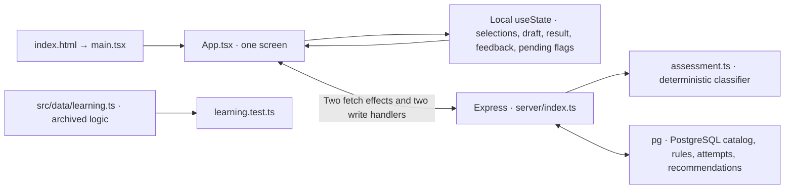
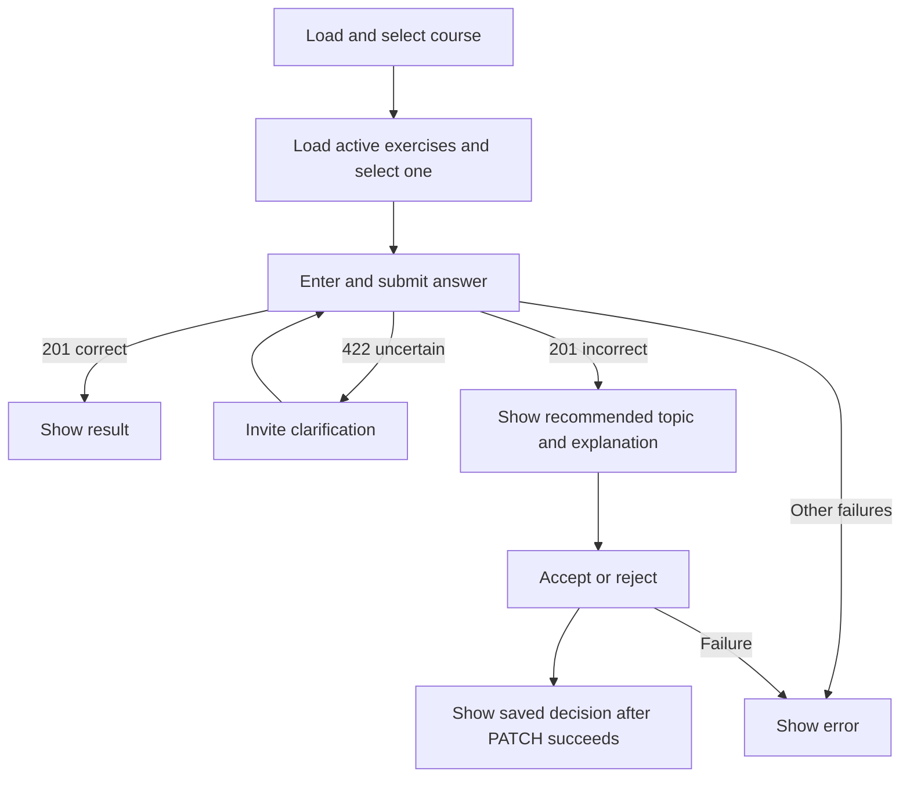

# FE-00 — Stage 3 frontend baseline audit

**Audit date:** 2026-11-26 (Europe/Kiev)

**Repository and base:** Andrew-web-dev-coder/ai-learning-recommendation-assistant, `main`

**Audited commit:** [`a81ed5f8bd4ab761207e8113af54a06d55d38e90`](https://github.com/Andrew-web-dev-coder/ai-learning-recommendation-assistant/tree/a81ed5f8bd4ab761207e8113af54a06d55d38e90), committed 2026-11-25. Clean checkout HEAD, local origin/main and live refs/heads/main agreed at inspection.

Assessment criteria are the frontend requirements supplied in FE-00. Linear search for FE-00 returned no accessible match. The repository's Stage 3 rubric traceability covers API documentation. No separate frontend scoring grid or evaluator interpretation was verified. Statuses below are evidence judgments against the supplied criteria.

## Baseline and file structure

The current MVP is an Express/TypeScript backend with PostgreSQL, deterministic assessment and two seeded diagnostics for introductory Python and Lithuanian grammar. The frontend is React/TypeScript. The October 2026 browser-only prototype recommended the next JavaScript topic from self-reported progress. Its data and tests remain tracked while the current React entry point uses Express. The current README introduction and API architecture describe the database-backed MVP. The archived README section, root architecture document and practice reports describe the earlier flow. [Current README](../../README.md) · [Archived architecture](../ARCHITECTURE.md) · [Current system architecture](../api/ARCHITECTURE.md) · [Reference seed](../../database/seeds/001_reference_data.sql) · [Assessment engine](../../server/assessment.ts)

```text
index.html                   Vite entry and React mount node
src/
  main.tsx                   StrictMode and root rendering
  App.tsx                    screen layout, workflow, state, types, fetch calls
  App.css                    shell, panels, controls, responsive rules
  index.css                  root typography and rendering defaults
  data/
    learning.ts              archived JavaScript catalog and recommendation logic
    learning.test.ts         archived catalog and recommendation tests
vite.config.ts               React plugin
tsconfig*.json               project references, src and Vite config checks
eslint.config.js             React hooks, refresh and TypeScript rules
server/                      Express routes, pg pool, classifier and Vitest tests
tests/                       HTTP contract suite and disposable DB harness
.github/workflows/ci.yml     static/unit checks and separate HTTP contract job
docs/api/                    contract, integration, design and verification docs
```

## Current architecture and user flow





Course and exercise reads abort when superseded or unmounted. Course selection resets downstream state. The screen keeps assessment and feedback in memory. All displayed steps share the same URL, and reloading starts a fresh screen. PostgreSQL persists committed attempts and decisions independently of browser state. [Entry](../../src/main.tsx#L1-L10) · [Reads and resets](../../src/App.tsx#L41-L165) · [Writes](../../src/App.tsx#L171-L306) · [Results](../../src/App.tsx#L510-L630)

## Minimum rubric traceability

**PASS** means the baseline evidence satisfies the supplied criterion. **PARTIAL** means some required behavior or evidence exists. **MISSING** means the implementation or documentation is absent at the baseline. **NOT VERIFIED** means the required outcome needs measurement or runtime evidence beyond the checks performed. The diagrams in this audit document the baseline and do not alter its documentation status.

| ID | Requirement | Status | Baseline evidence and gap |
| --- | --- | --- | --- |
| D1 | Frontend architecture diagram covering modules, components, routes and state | PARTIAL | The current system diagram treats React as a single node. The archived diagram maps the prior JS flow. Frontend component, URL and state boundaries are absent from the current diagrams. [API architecture](../api/ARCHITECTURE.md#components-and-dependencies) · [Archived diagram](../ARCHITECTURE.md#3-architecture-diagram) |
| D2 | Architecture approach description | PARTIAL | System responsibilities and request sequences are documented. Current frontend composition and state ownership have no dedicated rationale. [API architecture](../api/ARCHITECTURE.md) · [App state](../../src/App.tsx#L41-L54) |
| D3 | API schemas, methods and request/response examples | PASS | OpenAPI 3.0.3 has six operations, component schemas and examples. The guide shows catalog reads and both diagnostic writes and decisions. [OpenAPI](../api/openapi.json) · [Walkthrough](../api/README.md#powershell-integration-walkthrough) |
| D4 | User flow and navigation diagrams | PARTIAL | The diagnostic and decision sequence diagrams cover request flow. The repository has no separate current frontend screen/navigation diagram. [Sequence diagrams](../api/ARCHITECTURE.md#sequence-diagrams) · [Single root](../../src/main.tsx#L6-L10) |
| D5 | Technology stack justification | PARTIAL | README names the current stack. API design explains deterministic assessment trade-offs. The archived stack inventory gives limited rationale for current frontend choices. [README](../../README.md) · [API design](../api/API_DESIGN.md#resource-and-representation-design) |
| A1 | Modern SPA framework | PASS | React 19 renders a client-side root. [Dependencies](../../package.json) · [Entry](../../src/main.tsx#L1-L10) |
| A2 | Components, pages, services and hooks separated | MISSING | One App owns rendering, request handlers and effects. [App](../../src/App.tsx) · [Source tree](../../src) |
| A3 | At least 3–4 routes | MISSING | App renders directly beneath StrictMode. Step changes are local selection changes. [Entry](../../src/main.tsx#L1-L10) · [Course reset](../../src/App.tsx#L153-L165) |
| A4 | Local and global state, or justified absence of global state | PARTIAL | All state lives in App. Single-screen scope makes that choice understandable, but repository docs lack an explicit justification. [State](../../src/App.tsx#L41-L54) · [Architecture](../api/ARCHITECTURE.md) |
| A5 | Clear project structure | PARTIAL | Entry and CSS are identifiable. The live feature is concentrated in App, and the archived module remains under src/data. [Source tree](../../src) |
| A6 | Real API or mock integration | PASS | App calls four real Express operations. HTTP verification covers the server contract separately from browser integration. [App](../../src/App.tsx#L60-L306) · [Express routes](../../server/index.ts) |
| A7 | Typed data interfaces | PASS | App declares Course, Exercise, Recommendation and AttemptResult. Read/decision JSON lacks typed envelopes or runtime checks, and the optional result fields allow invalid combinations. [Types and reads](../../src/App.tsx#L8-L81) · [Decision parsing](../../src/App.tsx#L250-L270) |
| A8 | Centralized request handling | MISSING | Four direct fetch calls share an origin constant. Parsing and error handling remain per call. [App](../../src/App.tsx#L60-L306) |
| A9 | Loading and error states | PASS | loading, submitting, savingDecision and error drive visible pending and failure states. [Flags](../../src/App.tsx#L49-L54) · [Rendered states](../../src/App.tsx#L380-L507) · [Decision pending](../../src/App.tsx#L585-L613) |
| I1 | Modern bundler | PASS | Vite 8 with React plugin and TypeScript build. [Scripts](../../package.json) · [Vite config](../../vite.config.ts) |
| I2 | Component-based UI | PARTIAL | React renders App, whose JSX implements all sections inline. [Entry](../../src/main.tsx#L6-L10) · [App render](../../src/App.tsx#L337-L630) |
| I3 | Reusable components | MISSING | Repeated panels and buttons share CSS classes but lack reusable React primitives. [App render](../../src/App.tsx#L337-L630) · [Styles](../../src/App.css#L50-L100) |
| I4 | Layout components | MISSING | Semantic main, header and footer are inline within App. [App render](../../src/App.tsx#L337-L352) · [App footer](../../src/App.tsx#L617-L640) |
| I5 | UI library or custom UI components | PARTIAL | Custom-styled native controls and panels exist. No component library or extracted custom components. [Dependencies](../../package.json) · [Styles](../../src/App.css#L50-L119) |
| I6 | Controlled forms and validation | PASS | Controlled selects and textarea, blank/whitespace guard and a 5,000-code-unit limit. Submission uses a button click. Standalone labels and form semantics remain gaps. [Guard](../../src/App.tsx#L171-L177) · [Inputs and submit](../../src/App.tsx#L356-L493) |
| I7 | Data tables or lists | PASS | Course and exercise collections render as mapped selectable option lists. A dedicated list/table interpretation would require a catalog view. [Collections](../../src/App.tsx#L356-L429) |
| I8 | Filtering, searching or sorting | PARTIAL | Course selection scopes the exercise collection via an API path. SQL filters active exercises and orders the result. The UI has no explicit client-side search or sort control. [Read](../../src/App.tsx#L106-L147) · [SQL](../../server/index.ts#L158-L205) |
| I9 | Desktop and mobile responsiveness | NOT VERIFIED | Fluid width, clamp and 600px media rules show responsive intent. Browser viewport, zoom and overflow tests were outside the executed checks. [Styles](../../src/App.css#L17-L37) · [Breakpoint](../../src/App.css#L128-L137) |
| I10 | Clean/readable code | PARTIAL | Named functions and state make the flow legible. One large component combines transport, typing, rendering and transitions, with repeated catch/reset logic and inline styles. [App](../../src/App.tsx) |
| I11 | ESLint and Prettier or equivalent formatter | PARTIAL | ESLint and CI lint exist. No formatter dependency, configuration or check appears in the tracked tooling. [ESLint](../../eslint.config.js) · [Scripts](../../package.json) · [CI](../../.github/workflows/ci.yml) |
| I12 | Basic frontend logging | MISSING | Errors are stored/rendered, with no frontend logger. Existing console errors are server-side. [App handlers](../../src/App.tsx#L60-L306) · [Server](../../server/index.ts) |
| E1 | Global handler or Error Boundary | MISSING | StrictMode directly wraps App, and request catches are local. [Entry](../../src/main.tsx#L6-L10) · [App](../../src/App.tsx) |
| E2 | Clear user-facing errors | PARTIAL | role="alert", contextual fallbacks and uncertainty guidance exist. Raw exception messages, including JSON parser failures, can reach the UI. [Errors and guidance](../../src/App.tsx#L498-L560) · [Write parsing](../../src/App.tsx#L184-L223) |
| E3 | Correct HTTP 401/403/404/500 handling | PARTIAL | 404 and 500 use generic read failures or write messages without distinct recovery. 401/403 have no explicit frontend branches and are absent from the API contract. [App](../../src/App.tsx#L60-L306) · [OpenAPI](../api/openapi.json) |
| E4 | Loading for all async operations | PASS | Both reads use Loading…, attempt submission shows Checking…, and the decision action group disables buttons and shows Saving… on Accept for either decision. The latter is a presentation gap. [Catalog](../../src/App.tsx#L356-L407) · [Attempt](../../src/App.tsx#L480-L492) · [Decision](../../src/App.tsx#L585-L613) |
| T1 | Unit tests for at least three key current frontend units | MISSING | The src Vitest file targets the archived JS module. Server Vitest covers the classifier. [Archived tests](../../src/data/learning.test.ts) · [Backend tests](../../server/assessment.test.ts) |
| T2 | At least 1–2 frontend integration or E2E tests | MISSING | The HTTP suite drives Express over HTTP and asserts PostgreSQL state. It renders no React UI. [HTTP suite](../../tests/api.contract.mjs) · [CI](../../.github/workflows/ci.yml) |
| T3 | Tests for forms, state or client-side API | MISSING | Current App forms, state transitions and browser request handling lack automated coverage. [App](../../src/App.tsx) · [Vitest and CI scripts](../../package.json) · [Contract suite](../../tests/api.contract.mjs) |

**Minimum totals:** 9 PASS, 13 PARTIAL, 10 MISSING, 1 NOT VERIFIED. Counts treat compound criteria as one row each.

## API capabilities and client implications

| Operation | Capability | Documented statuses |
| --- | --- | --- |
| GET `/api/health` | Database connectivity diagnostic for operators | 200, 500 |
| GET `/api/courses` | Full course catalog | 200, 500 |
| GET `/api/courses/{courseId}/topics` | Ordered topics for an existing course. Available to the proposed course page. | 200, 400, 404, 500 |
| GET `/api/courses/{courseId}/exercises` | Active exercises with prompts and topic IDs | 200, 400, 404, 500 |
| POST `/api/attempts` | Classify an answer. 201 correct commits an attempt alone. 201 incorrect commits an attempt and a pending recommendation together. 422 uncertainty and configuration failures do not persist an attempt. | 201, 400, 404, 413, 415, 422, 500 |
| PATCH `/api/recommendations/{recommendationId}/decision` | One pending-to-accepted/rejected transition. A repeat or competing write returns 409. | 200, 400, 404, 409, 413, 415, 500 |

The four GET operations include health and three catalog reads. The frontend currently uses the courses and exercises reads and both writes. Catalog collections are complete arrays without pagination or query filters. The contract does not expose attempt or recommendation lookup/history, account or ownership APIs, analytics, learning-material URLs or LLM operations. Topic metadata and recommendation explanations are available. Date, progress and history screens would require separate product and API work. [Contract](../api/openapi.json) · [Handlers](../../server/index.ts) · [API design](../api/API_DESIGN.md)

### Risks and priorities

| Priority | Risk and baseline evidence | Implementation response |
| --- | --- | --- |
| High | Every browser submits as the same demo learner. CORS allows a single local frontend origin, and the API has no authorization. [App constants](../../src/App.tsx#L5-L6) · [Middleware](../../server/index.ts#L7-L20) · [Security](../api/SECURITY.md) | Use synthetic demo data and configurable API origin or a local proxy. Shared deployment is a separate scope decision. |
| High | A lost write response can hide a commit. Repeating POST can duplicate attempts. PATCH 409 provides no winning decision, and no read operation can reconcile it. [Retry design](../api/API_DESIGN.md#idempotency-and-retry-safety) | Block duplicate clicks, avoid automatic mutation retries, preserve the draft and show unknown write outcome. On 409 disable further changes without inferring a winner. |
| High | Unconditional write JSON parsing can replace documented HTML 400/413/415 or proxy errors with parser text. 422 uncertainty and missing configuration need distinct treatment. [App writes](../../src/App.tsx#L184-L306) · [Error taxonomy](../api/API_DESIGN.md#error-taxonomy) | Normalize errors centrally using status, media type and response discriminator. Give 404 a catalog recovery path, 500 a service failure state, and synthetic 401/403 safe status-specific feedback without introducing login. |
| Medium | The client converts exercise IDs using Number without a safe-integer guard. Path IDs and returned IDs allow a larger range than POST body IDs. App state types cover only parts of the contract. [App request](../../src/App.tsx#L185-L200) · [Representation](../api/API_DESIGN.md#resource-and-representation-design) | Keep decimal IDs as strings in URLs/state, validate the positive safe-integer range at the POST edge, and model correct, incorrect, uncertain and failure variants separately. |
| Medium | Shared read flags and generic error panel can conflate fetch failures with empty states. Route extraction would introduce stale mutation and navigation races without explicit ownership. [Effects and resets](../../src/App.tsx#L60-L165) · [Exercise state](../../src/App.tsx#L389-L429) | Key queries and results by course/exercise, protect newer state from late responses, and render separate pending, empty and error views. |
| Medium | Classifier coverage depends on two known seeded exercise IDs and approved normalized variants. [Assessment](../../server/assessment.ts) · [Seed](../../database/seeds/001_reference_data.sql) | Describe the demo scope, preserve uncertainty and avoid inferring mastery from the outcome. |
| Medium | Selects and textarea have no explicit associated labels. Most progress feedback is plain text. Breakpoint rules alone leave reflow and keyboard behavior unverified. [Controls](../../src/App.tsx#L356-L493) · [Pending decision](../../src/App.tsx#L585-L613) · [CSS](../../src/App.css#L128-L137) | Add accessible fields and status announcements, then verify keyboard flow, focus, contrast, zoom and viewport behavior. |
| Medium | Current build type-checks src and the Vite config, without a server TypeScript project or explicit strict compiler options. Frontend behavior can regress while the current suite stays green. [TS references](../../tsconfig.json) · [App config](../../tsconfig.app.json) · [Node config](../../tsconfig.node.json) · [CI](../../.github/workflows/ci.yml) | Add targeted frontend regression coverage early. Consider strict checks incrementally when adding contract types. |

## Advanced directions and feasibility

| Direction | Baseline status | Evidence and proposed assessment evidence |
| --- | --- | --- |
| Advanced Architecture | MISSING | One eager entry and monolithic App. Adopt a small feature-based structure with lazy page modules, a shared shell, and documented import boundaries. Demonstrate a route map, component/state diagrams and generated route chunks. [Entry](../../src/main.tsx) · [App](../../src/App.tsx) |
| Advanced State Management | MISSING | Local App state and effects own both server and client state. RTK Query can own catalog caches and mutations. Redux Toolkit can coordinate the current in-memory result across routes, with selectors for route context and decision eligibility. Demonstrate cache reuse, selected-result transitions, stale-response isolation and mutation tests. [State and effects](../../src/App.tsx#L41-L147) |
| Performance | PARTIAL | Vite emits a production bundle and catalog reads abort on cleanup. There is no verified route splitting, performance budget or browser profile. Record reproducible cold and warm results before optimizing. Measure JS transfer and render behavior after route splitting and read caching. Add memoization only when profiling shows a cost. [Vite config](../../vite.config.ts) · [Effects](../../src/App.tsx#L60-L147) |
| Advanced UI/UX | PARTIAL | Styled panels, controls, responsive intent and an alert exist. A reusable design system, themes and accessibility evidence remain future work. Use CSS tokens and accessible primitives for light/dark themes, then demonstrate keyboard, narrow/wide layout, contrast and zoom checks. [Styles](../../src/App.css) · [Alert](../../src/App.tsx#L498-L507) |

The supplied criteria do not specify whether maximum credit requires all four directions, a subset, or particular metrics. Confirm route counting for parameterized pages and guarded result navigation, whether dropdowns qualify as lists, whether course scoping qualifies as filtering, whether synthetic/proxy 401 and 403 handling qualifies for an unauthenticated API, and what evidence is required for performance and accessibility. The plan addresses architecture, state and UI/UX directly and adds measurable performance work where it fits the MVP. A single SPA and the existing API suffice.

## Recommended frontend architecture

Keep React and Vite to reuse the current render model and build pipeline. Use TypeScript to model the OpenAPI payload variants and verify ambiguous responses at the network boundary. A router provides durable URLs and independent lazy page modules. RTK Query consolidates request lifecycle, cache keys and loading/error state. CSS custom properties and semantic native controls provide theming and accessible primitives with a small runtime footprint.

Use `app/` for router, shell, providers, error boundary and store. Use `pages/` for route composition, `features/` for catalog browsing, diagnostic submission and recommendation decisions, and `shared/` for transport, DTOs, form primitives and layout tokens. Keep imports flowing from app to pages to features to shared, with page modules consuming feature exports. Maintain the archived module and its tests. Document route fallback behavior for deployment and preserve the local demo entry via a redirect from `/`.

| Proposed frontend route | Existing capability and navigation |
| --- | --- |
| `/courses` | Show the title/code catalog from GET courses. Offer visible client-side title/code search and an empty result state. |
| `/courses/:courseId` | Display topics and active exercises from the existing collection GETs. Use course metadata from the catalog. Link from exercise rows to the diagnostic. |
| `/courses/:courseId/exercises/:exerciseId` | Pick the exercise from the course collection, show its prompt and submit via POST attempts. Handle missing/inactive IDs without fabricating a detail API. Keep uncertain answers on the form with revision guidance. |
| `/courses/:courseId/exercises/:exerciseId/result` | Show the confirmed in-session result. Display the recommendation and decision controls only on the applicable outcome. A refresh or direct URL without matching state offers a link back to the diagnostic, since no read endpoint can recover the result. Never resubmit automatically. |

Add a catch-all for invalid URLs. The four functional routes above are the proposed rubric evidence. Navigation runs catalog → course → diagnostic → in-session result, with back links and explicit empty, failure and recovery states.

### Proposed Redux Toolkit and RTK Query boundaries

- Register one `learningApi` API slice with typed `getCourses`, `getCourseTopics`, `getCourseExercises`, `submitAttempt` and `saveDecision` endpoints. Keep health diagnostics outside the learner workflow. Use a configurable base URL, a typed transport error, and media-aware decoding that preserves HTTP status even for HTML or malformed bodies.
- Key catalogs by operation and course ID and reuse cached arrays on navigation. Drive route-specific pending states from endpoint flags. Mutations change attempt/decision state and leave catalog caches intact. Limit any network retry policy to safe reads.
- Keep URL selections in route params, draft text and validation in local form state, server collections in RTK Query, and confirmed assessment/result context in one ephemeral Redux slice keyed by the active course and exercise. Avoid persistent learner payloads. Clear or ignore results that belong to another route context.
- Use selectors for current exercise, course-matched result and eligibility to decide. Memoize composed data only where stable references or measurement warrant it. Have mutation completion update matching workflow state, distinguish the uncertain 422 payload, and use the confirmed PATCH response for the stored decision.
- Place an error boundary at the shell/route level and use a small sanitized client logger for operation, status category and failure class. Keep user-submitted text, payloads, learner identifiers and credentials out of logs.

## Implementation sequence

| Task | Deliverable and acceptance evidence |
| --- | --- |
| FE-01 — Route and architecture foundation | Establish feature boundaries, app shell and lazy routes, with navigation and deep-link fallback. Keep existing diagnostic behavior reachable through the shell. Add living frontend architecture, state and navigation diagrams plus stack rationale. Verify direct links and invalid URLs. |
| FE-02 — Typed API and workflow state | Introduce the RTK Query/store boundaries, connect current GETs and mutations, and implement route-safe state, status handling, Error Boundary and sanitized logging. Test media-aware parsing, ID bounds, 422 variants, 409 and ambiguous writes. |
| FE-03 — Complete minimum UI requirements | Render searchable catalog, course topic/exercise lists, validated diagnostic form and result actions via reusable layout and UI components. Verify empty, pending, validation and recovery paths. Add formatter and CI check in scope. |
| FE-04 — Frontend automated coverage | Cover at least three current units such as transport/error mapping, form validation and workflow reducer/selectors. Add at least two frontend integration or browser scenarios covering navigation and saved decision, and uncertainty/revision or failure recovery. Use contract-shaped fixtures and verify the live demo path with disposable PostgreSQL. |
| FE-05 — Design system and accessibility | Implement reusable semantic primitives, design tokens, light/dark themes, responsive layout and focus/announcement behavior. Record keyboard, contrast, zoom and desktop/mobile verification in both themes. |
| FE-06 — Performance and assessment evidence | Compare route chunks and reproducible browser timings with an explicit setup and budget. Check cache reuse and define any optimization from measured bottlenecks. Re-run audit checks and map screenshots, reports and test cases to the rubric for human review. |

## Verification

Executed on the clean baseline with Node v24.22.3 and npm 11.19.1. Commands completed successfully. The separate [CI workflow](../../.github/workflows/ci.yml) uses Node 24 and PostgreSQL 17.

| Check | Actual result |
| --- | --- |
| `npm ci --cache /workspace/scratch/fe-npm-cache` | PASS. Installed 278 packages. npm emitted an install-script policy warning for the esbuild postinstall. Subsequent tests and build succeeded. |
| `npm run test` | PASS. Two files, 19 tests. The archived JS catalog/recommender accounts for 13. The live backend's classifier accounts for six. Zero automated tests exercise the current React frontend. |
| `npm run lint` | PASS. No ESLint diagnostics. |
| `npm run build` | PASS. TypeScript project checks and Vite 8.3.3 production build. Initial JS was 226.10 kB raw / 70.56 kB gzip. CSS was 1.52 kB raw / 0.73 kB gzip. Sizes are build output, with browser timings unmeasured. |
| OpenAPI validation | PASS. CI's pinned swagger-cli 4.0.4 validated docs/api/openapi.json. npm emitted the validator's deprecation notice. |
| `npm run test:contract` | PASS. 20 passed, 0 failed, skipped or cancelled. Used a disposable PostgreSQL 17.12 container on a randomly allocated loopback port and the suite's per-run fixture database. The suite loaded the initial schema, indexes and reference seed, verified live Express and DB side effects, and the container was removed after the run. |

All requested commands ran. Browser responsiveness, accessibility compliance, Lighthouse metrics and browser demo behavior remain unverified. Frontend E2E coverage is absent. The standalone database test SQL was outside the requested command set. The unresolved assessment dependency is the evaluator's interpretation of the ambiguous frontend criteria. [Test layers and scope](../api/TESTING.md)

The next task is **FE-01**. A navigable shell and explicit route/module boundaries give FE-02 a defined place to attach the API and state layers.
