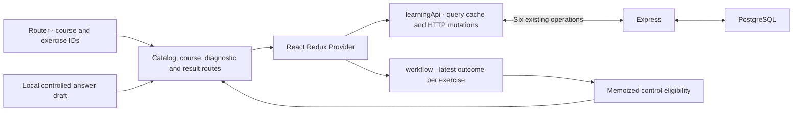
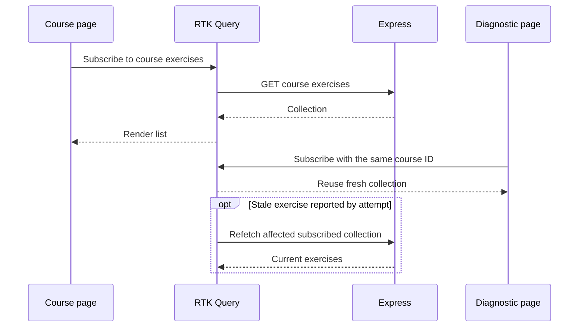
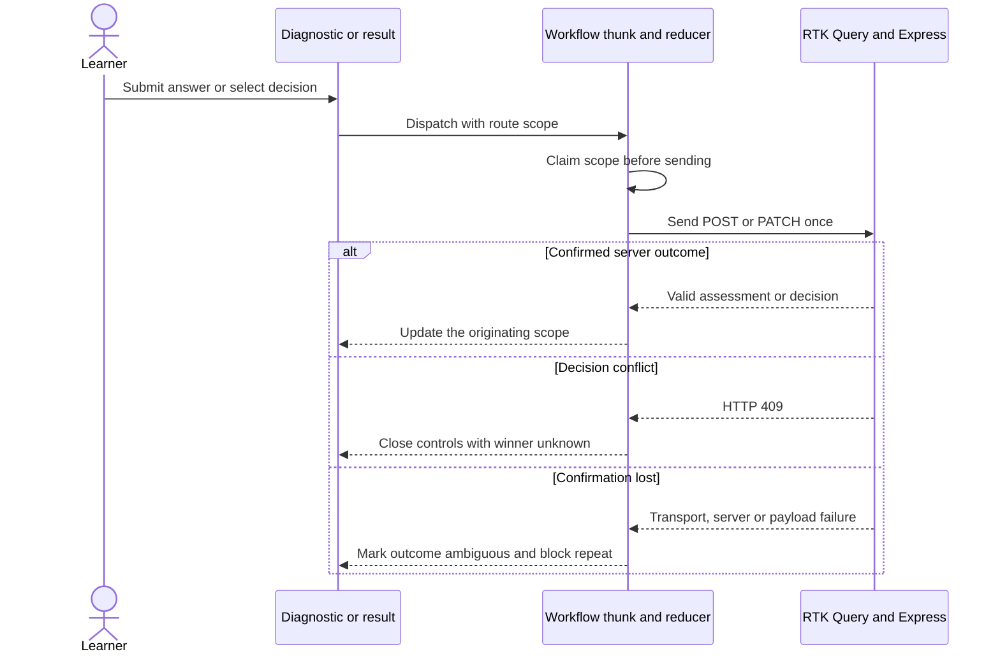

# FE-02 — Frontend state management

FE-02 starts from `a9caa886c465dae24685e67d757eaa0006cef62d`, the merge of PR #12. The supplied frontend rubric and FE-00 criteria guide the implementation. A Linear search for FE-02 returned no match. Express and PostgreSQL remain authoritative for assessment and persistence. [Baseline rubric](BASELINE_AUDIT.md#minimum-rubric-traceability) · [Frontend architecture](ARCHITECTURE.md) · [OpenAPI contract](../api/openapi.json)

## Store and ownership

Redux Toolkit configures the feature reducer and RTK Query reducer and middleware. React Redux's Provider wraps the router. `RootState` and `AppDispatch` are inferred from the store and exposed through typed hooks. Redux Toolkit's default middleware enforces serializability and immutability in development. The workflow uses Immer case reducers. The store has no persistence, and Redux DevTools is disabled because request actions temporarily include submitted answers. [Store](../../src/app/store.ts) · [Provider](../../src/main.tsx) · [Typed hooks](../../src/shared/storeHooks.ts)



| Data | Owner | Lifetime |
| --- | --- | --- |
| Course and exercise selection | URL params and the validated, keyed diagnostic outlet | Current route. String IDs stay exact. |
| Answer text and input validation | Controlled diagnostic form | Current form mount. Kept during uncertainty and failures on that form. |
| Catalog and operational health | `learningApi` query cache | Per endpoint and argument, subject to cache policy. |
| Pending write, uncertainty, latest confirmed assessment and decision status | `workflow` slice | One entry per attempted course/exercise in the running tab. Returning in-app can recover its latest outcome or unresolved-write lock. |
| Attempt and decision persistence | Express and PostgreSQL | Backend-defined. The frontend confirms a write from its documented response. |

The diagnostic and result select only the current pair's workflow entry. A memoized selector reuses the derived eligibility object while the entry is unchanged. The other selectors return existing references. RTK mutations run with `track: false` because the workflow reducer owns their UI lifecycle and confirmed outcome. There is no duplicate mutation-result cache and no answer text in the Redux state. The shared hooks use a type-only import of the app's store types. [Slice and selectors](../../src/features/learning/workflowSlice.ts) · [Write thunks](../../src/features/learning/workflowActions.ts) · [Session selection](../../src/features/learning/session.ts)

## Endpoint mapping

| RTK Query endpoint | HTTP operation | Consumer and cache key |
| --- | --- | --- |
| `getHealth` | GET `/api/health` | Operational query with no argument. Available to consumers. Learner routes do not call it. |
| `getCourses` | GET `/api/courses` | Catalog and course title. One shared key with no argument. |
| `getCourseTopics` | GET `/api/courses/{courseId}/topics` | Course page. Endpoint plus decimal course ID. |
| `getCourseExercises` | GET `/api/courses/{courseId}/exercises` | Course and diagnostic pages. Endpoint plus decimal course ID. |
| `submitAttempt` | POST `/api/attempts` | Answer thunk. Converts the validated exercise ID to a positive safe integer only at the POST boundary. |
| `saveDecision` | PATCH `/api/recommendations/{recommendationId}/decision` | Decision thunk. Sends the requested enum and verifies the confirmed attempt ID, recommendation ID and decision. |

The service uses the existing public `VITE_API_URL` configuration and synthetic learner ID. The endpoint types reflect the contract. The base query checks the response envelope, distinguishes JSON from text or HTML, and normalizes errors. Writes additionally verify the expected HTTP success status and confirmation payload before updating the workflow. Read payload fields are typed from the contract. Full runtime validation of all read properties is outside this change. [Service](../../src/features/learning/api.ts) · [Error normalization](../../src/features/learning/apiErrors.ts) · [API integration guide](../api/README.md#endpoints)

## Cache and query lifecycle

Catalog data stays cached for 120 seconds after the last unsubscribe. A new subscription revalidates catalog data if the last success is at least 60 seconds old. Health uses a shorter 15-second unused lifetime. Active subscriptions refetch on reconnect. There is no polling, focus-triggered refetch or automatic retry loop. Catalog and diagnostic views retain data for the same query key during background fetches, distinguish empty data from failures, and offer a manual refresh or retry. Course retry fetches only failed reads. In-flight GETs can finish into their own cache entries after navigation. Pages use `currentData` for their query argument.

Successful POST and PATCH operations leave catalog keys warm because attempts and decisions do not change the catalog. If the attempt endpoint explicitly reports `Active exercise not found`, an exercise may have been removed since the list was fetched. The mutation invalidates only the corresponding `Exercises` tag, refetching an active subscription or evicting an unused entry. An unrelated course, topic list or missing learner does not trigger this invalidation. The API has no stable machine-readable error code for the inactive exercise, so the tag uses the documented message alongside HTTP 404. [Service policy](../../src/features/learning/api.ts) · [Course UI](../../src/pages/CoursePage.tsx) · [API error taxonomy](../api/API_DESIGN.md#error-taxonomy)



## Writes, errors and recovery

POST and PATCH claim the relevant exercise synchronously before sending. A second submit or decision while the first is pending makes no request. Completion carries the original pair, and a decision completion must still match the original attempt. Only the originating form can navigate to its result while it remains active. The UI displays confirmed success only after the server response passes validation. Writes have a 12-second transport timeout, do not follow redirects and have no automatic retry.

| Outcome | UI and recovery |
| --- | --- |
| Initial GET, refresh, empty data | Announce loading or refresh, retain same-key data while refreshing, and show a separate empty message for a successful empty collection. |
| GET network/timeout, 5xx or unexpected response | Show a safe alert and read retry. Existing data remains visible after a failed refresh. |
| 400, 413, 415, 401/403, or 404 | Show specific invalid request, access or missing resource guidance. HTML and malformed JSON retain HTTP status. 401 and 403 are defensive fallbacks for infrastructure responses. The current API has no authentication. |
| POST 201 correct or incorrect | Show the confirmed result. A correct response has no recommendation. |
| POST 422 uncertainty or missing configuration | Show separate revision and configuration messages. Preserve the answer draft. |
| PATCH 409 | Close decision controls. Explain that a decision already exists and the service does not disclose its value. |
| POST or PATCH network loss, timeout, 5xx or invalid confirmation | Treat the outcome as ambiguous. Keep the current draft on the form, block another POST for that exercise in this tab, or close that recommendation's decision controls. Other exercises remain available. |
| Refresh or direct result URL in a fresh tab | Offer a link back to the diagnostic without requesting or resubmitting an attempt. |
| Unexpected route/render error | Show a generic recovery view with a link to the catalog. |



The contract offers neither write idempotency nor a reconciliation read. The tab's confirmation and safety lock are temporary. Reloading or opening another tab cannot prove the result of an earlier write. Learners should continue with another exercise or ask the demo maintainer about an unresolved write. The app never starts a write on mount. The pending-only backend update is the authority when multiple clients decide concurrently. [Answer form](../../src/features/learning/AnswerForm.tsx) · [Result UI](../../src/features/learning/AssessmentResult.tsx) · [Route recovery](../../src/app/RouteError.tsx) · [API retry semantics](../api/API_DESIGN.md#idempotency-and-retry-safety)

## Rubric-to-evidence mapping

| FE-00 criterion | FE-02 evidence |
| --- | --- |
| Advanced State Management and A4 | Redux Toolkit store, Provider, inferred types, scoped workflow actions and memoized control eligibility. Drafts and route selection remain with their natural owners. [Store](../../src/app/store.ts) · [Slice](../../src/features/learning/workflowSlice.ts) |
| A6, A7, A8 | Typed, centralized RTK Query client maps all six documented operations. [API service](../../src/features/learning/api.ts) |
| A9, E2, E3, E4 | Initial/background pending, empty, error and decision states. HTTP status handling includes 401, 403, 404, 500 and documented recovery cases. [Query feedback](../../src/features/learning/QueryFeedback.tsx) · [Error mapping](../../src/features/learning/apiErrors.ts) |
| E1 | Router root provides recovery for route and rendering errors. [Route config](../../src/app/routes.tsx) |
| T3 and client integration evidence for T2 | Store and real RTK Query middleware exercise cache, transport, reducers and workflow with HTTP fixtures. Live Chromium separately checks the routed flow. [Integration tests](../../src/features/learning/learning.integration.test.ts) |
| D1, D2 and D5 | State diagrams, ownership decisions and stack rationale in these frontend documents. [Architecture](ARCHITECTURE.md) |
| Performance direction | Shared catalog cache, measured request counts and production chunk sizes. No timing or Lighthouse measurement. |

## Reproduction and verification

From the repository root, use Node 24 and run these commands. The [API testing guide](../api/TESTING.md#reproduce-locally) describes how to set up `CONTRACT_DB_URL` with isolated PostgreSQL before invoking the contract suite.

```sh
npm ci
npm run lint
npm run test
npm run build
npx --yes @apidevtools/swagger-cli@4.0.4 validate docs/api/openapi.json
npm run test:contract
```

The CI Vitest command runs the FE-02 tests automatically. To focus on the frontend store and service, run `npm run test -- src/features/learning/learning.integration.test.ts`. Integration fixtures cover all endpoints, concurrent deduplication, hot revisit, idle health eviction, background failure and recovery, scoped 404 invalidation, stable selectors, pending write guards, late completion, uncertainty, conflict, and committed-write confirmation failures. Existing route, classifier and archived practice tests remain in the suite.

For live smoke verification, start the backend with a disposable reference database as described in the [API guide](../api/README.md#getting-started). Run `npm run build` and `npm run preview -- --host localhost --port 5173 --strictPort`. Open `http://localhost:5173`, navigate through each course and use the API guide's [Python](../api/README.md#python-diagnostic-and-acceptance) and [Lithuanian](../api/README.md#lithuanian-diagnostic-and-rejection) answers. Inspect the Network panel while traversing catalog → course → exercise → result. Use browser back links to observe cache reuse, or Refresh to revalidate. Reload the result page and confirm the recovery link and absence of write traffic.

### Observed results

- Node 24.22.3 and npm 11.19.1 completed lockfile installation, lint, Vitest and the Vite production build. Vitest passed 55 tests across four files, including 23 new cases. OpenAPI validation passed with the CI-pinned validator.
- The live HTTP contract suite passed 20 tests against disposable PostgreSQL 17.12. It verified the existing response contract and persistence independently of the frontend.
- Headless Chromium 156 used the production preview with live Express and a seeded disposable DB. Both tracks showed their recommendations and saved decisions. The smoke also covered uncertainty, a correct result, refresh recovery with no writes, delayed navigation, read pending/error/retry, and course/exercise cache reuse. The browser observed one course catalog GET and one exercise collection GET per visited course during the initial forward navigation, with no catalog reload after a successful write.
- A separate client committed a decision first and the browser displayed the real 409 without guessing the winner. Separate intercepted deliveries let PostgreSQL commit a POST and a PATCH before dropping their browser responses. The UI preserved the unknown outcome and kept the affected controls closed.
- Chromium rendered all six Mermaid diagrams across the two frontend documents. Local documentation links and staged diff whitespace checks passed.

### Production bundle comparison

Vite 8.3.3 build outputs in kB, measured before and after under the same toolchain.

| Asset | FE-01 raw / gzip | FE-02 raw / gzip |
| --- | ---: | ---: |
| Entry JS | 322.51 / 101.99 | 411.15 / 131.57 |
| Catalog route | 0.61 / 0.35 | 0.66 / 0.40 |
| Course route | 1.34 / 0.61 | 1.69 / 0.72 |
| Diagnostic route | 2.48 / 1.20 | 2.48 / 1.18 |
| Result route | 1.78 / 0.74 | 2.09 / 0.86 |
| Not Found route | 0.25 / 0.20 | 0.25 / 0.20 |
| CSS | 1.28 / 0.65 | 1.28 / 0.65 |

FE-01 emitted shared read and session hooks at 0.39 / 0.27 and 0.07 / 0.09 kB. FE-02 emits shared query feedback and workflow thunks at 0.35 / 0.26 and 1.44 / 0.67 kB. The entry grew as the store and query client became part of startup. Request counts establish reuse under the smoke setup. Runtime speed and broader accessibility remain unmeasured.

## FE-03 handoff

Build the searchable catalog and improve the existing form, result and accessible status patterns with reusable UI components. Keep filter text local or in the URL and derive the filtered view from cached course data. Keep write recovery and RTK Query ownership intact. The formatter, persistent browser regression infrastructure, systematic accessibility, theme system and measured performance work remain later evidence. Backend idempotency, reconciliation and stable machine-readable errors require separate API scope.
